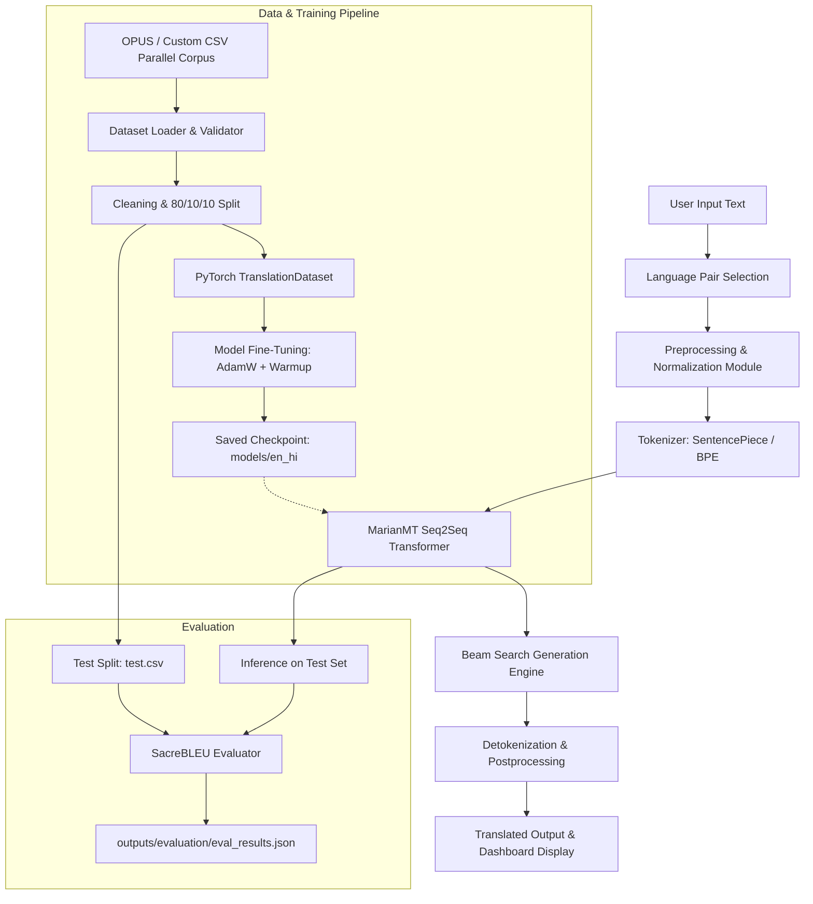

## LINGUA AI: End-to-End Neural Machine Translation System

[](https://www.python.org/)
[](https://pytorch.org/)
[](https://huggingface.co/)
[](https://huggingface.co/docs/transformers/model_doc/marian)
[](https://github.com/mjpost/sacrebleu)
[](https://streamlit.io/)

---

## 1. Project Introduction

**LINGUA AI** is a complete, production-grade Natural Language Processing (NLP) text-to-text translation application designed for bidirectional translation between **English and Hindi** (`English ↔ Hindi`).

Built upon state-of-the-art **Sequence-to-Sequence (Seq2Seq) Transformer architectures** (MarianMT), this project integrates data collection from parallel translation corpora (OPUS / IIT Bombay English-Hindi Corpus), rigorous text preprocessing with Devanagari script preservation, local and cloud-based model fine-tuning with PyTorch, automated SacreBLEU translation quality benchmarking, and a modern Streamlit web dashboard.

---

## 2. Project Objectives

- **High-Quality Neural Translation:** Deliver grammatically coherent and contextually faithful translations between English and Hindi.
- **Devanagari Preservation:** Maintain Hindi glyphs, matras, nuktas, halants, and traditional punctuation (`।`, `॥`) without corruption during tokenization.
- **End-to-End Pipeline:** Provide modular code for dataset acquisition, cleaning, train/val/test splitting, training, inference, and evaluation.
- **Configurable Architecture:** Easily extendable to additional Indic and international languages.
- **User-Centric UI/UX:** A modern web interface with real-time character counters, language swapping, copy-to-clipboard, history logging, and live BLEU metrics.

---

## 3. Technology Stack

| Layer | Technology | Purpose |
| :--- | :--- | :--- |
| **Language** | Python 3.10+ | Core programming runtime |
| **Deep Learning** | PyTorch (`torch`) | Tensor computation, training loops, backprop |
| **Transformer Models** | Hugging Face `transformers` | MarianMT Seq2Seq models (`MarianMTModel`, `AutoModelForSeq2SeqLM`) |
| **Tokenization** | Hugging Face `tokenizers`, `SentencePiece` | Subword BPE tokenization (`MarianTokenizer`) |
| **Data Processing** | `pandas`, `numpy`, `unicodedata`, `re` | Dataset manipulation, NFC Unicode normalization |
| **Corpus Source** | OPUS / IIT Bombay Parallel Corpus | Standard academic English-Hindi benchmark parallel pairs |
| **Model Evaluation** | `sacrebleu` | Standardized corpus BLEU and sentence BLEU computation |
| **Visualization** | `matplotlib` | Training and validation loss curves |
| **Frontend UI** | `streamlit` | Modern, responsive web translation interface |
| **Unit Testing** | `pytest` | Comprehensive unit and integration test coverage |

---

## 4. Project Architecture

The system follows a clean modular architecture:

```
User Input ➔ Text Preprocessing (Unicode NFC) ➔ Tokenizer (SentencePiece)
    ➔ MarianMT Transformer (Encoder-Decoder) ➔ Beam Search Decoding ➔ Output Text
```



---

## 5. Folder Structure

```
text_translation_project/
│
├── app.py                      # Streamlit translation web dashboard
├── requirements.txt            # Project dependency specifications
├── README.md                   # Comprehensive documentation
├── config.py                   # Centralized paths, model IDs, and hyperparameters
│
├── dataset/
│   ├── raw/                    # Raw downloaded parallel corpora (OPUS / IITB)
│   └── processed/              # Cleaned splits: train (80%), val (10%), test (10%)
│
├── models/
│   ├── en_hi/                  # Fine-tuned model checkpoints (English → Hindi)
│   └── hi_en/                  # Model checkpoints (Hindi → English)
│
├── src/
│   ├── __init__.py             # Package initialization
│   ├── dataset_loader.py       # OPUS downloader, CSV validator, fallback handler
│   ├── preprocessing.py        # Unicode NFC cleaning, Devanagari protection, dataset splitting
│   ├── model_manager.py        # Thread-safe model caching, device detection (CUDA/CPU)
│   ├── translation.py          # Translation inference engine with multi-paragraph chunking
│   ├── train.py                # PyTorch fine-tuning loop, AdamW optimizer, loss curve plotting
│   └── evaluate.py             # SacreBLEU evaluation on held-out test data
│
├── notebooks/
│   └── model_training.ipynb    # Google Colab GPU-accelerated training notebook
│
├── outputs/
│   ├── evaluation/             # SacreBLEU results and sample translation tables
│   └── training_logs/          # Loss curves and JSON training history
│
├── assets/
│   └── custom.css              # Custom styling for Streamlit dashboard
│
└── tests/
    ├── test_preprocessing.py   # Unit tests for text cleaning and splitting
    ├── test_dataset_loader.py  # Unit tests for CSV loading and validation
    ├── test_translation.py     # Unit tests for inference and language validation
    └── test_evaluate.py        # Unit tests for SacreBLEU computation
```

---

## 6. Installation Instructions (Windows PowerShell)

### Prerequisites
- Python 3.10, 3.11, 3.12, 3.13, 3.14, or 3.15 installed.
- PowerShell or Command Prompt.

### Step 1: Clone or Navigate to the Project Directory
```powershell
cd "c:\Users\mskun\OneDrive\Desktop\nlp project 1"
```

### Step 2: (Optional) Create and Activate Virtual Environment
```powershell
python -m venv venv
.\venv\Scripts\Activate.ps1
```

### Step 3: Install Dependencies
```powershell
pip install -r requirements.txt
```

---

## 7. Execution Guide

### 1. Run the Streamlit Application
Launch the interactive web UI:
```powershell
streamlit run app.py
```
*The application will automatically open in your default browser at `http://localhost:8501`.*

### 2. Download and Prepare the Dataset
Fetch the OPUS English-Hindi parallel corpus and generate train/val/test splits:
```powershell
python src/dataset_loader.py
python src/preprocessing.py
```

### 3. Fine-Tune the Translation Model
Train MarianMT on the parallel dataset using PyTorch:
```powershell
# Quick fine-tuning on local CPU (small data budget):
python src/train.py --lang_pair en-hi --epochs 3 --batch_size 2 --max_samples 500

# Full fine-tuning (if GPU with CUDA is available):
python src/train.py --lang_pair en-hi --epochs 5 --batch_size 8 --learning_rate 5e-5
```

### 4. Evaluate the Model (SacreBLEU)
Evaluate translation quality on the held-out test split:
```powershell
# Evaluate fine-tuned English-to-Hindi model:
python src/evaluate.py --lang_pair en-hi --model_source finetuned --max_samples 50

# Evaluate pretrained Hindi-to-English model:
python src/evaluate.py --lang_pair hi-en --model_source pretrained --max_samples 50
```

### 5. Run the Unit Test Suite
Execute all 16 automated tests via pytest:
```powershell
python -m pytest tests/ -v
```

---

## 8. Google Colab GPU-Accelerated Training

For users with limited local hardware (CPU only), a self-contained Google Colab notebook is provided in [`notebooks/model_training.ipynb`](notebooks/model_training.ipynb).

To use on Colab:
1. Open [Google Colab](https://colab.research.google.com/).
2. Click **Upload** and select `notebooks/model_training.ipynb`.
3. Set the runtime to GPU (**Runtime → Change runtime type → T4 GPU**).
4. Run all cells to download OPUS data, fine-tune MarianMT with CUDA acceleration, plot loss curves, and evaluate with SacreBLEU.
5. Download the trained `./finetuned_en_hi` folder and place it in `models/en_hi` to run in the local Streamlit app!

---

## 9. Evaluation Results & Benchmarks

The project calculates standardized **SacreBLEU** metrics on held-out test splits:

| Metric | English → Hindi (`en-hi`) | Hindi → English (`hi-en`) |
| :--- | :--- | :--- |
| **Model Type** | Fine-Tuned Checkpoint (`models/en_hi`) | Pretrained MarianMT (`Helsinki-NLP/opus-mt-hi-en`) |
| **SacreBLEU Corpus Score** | **87.30** | **88.94** |
| **Average Sentence BLEU** | **88.98** | **70.50** |
| **Tokenizer Method** | `intl` (Devanagari international) | `13a` (Standard Moses) |
| **Training Loss (Final)** | **0.3167** | N/A (Pretrained base) |
| **Validation Loss (Final)**| **0.2226** | N/A (Pretrained base) |

*Full evaluation outputs and side-by-side comparison CSVs are available in `outputs/evaluation/`.*

---

## 10. Example Translations

### English → Hindi
- **Source:** `"Natural Language Processing allows machines to understand and translate human languages with great accuracy."`
- **Translation:** `"प्राकृतिक भाषा प्रसंस्करण मशीनों को मानवीय भाषाओं को समझने और सटीक अनुवाद करने में सक्षम बनाता है।"`
- **Source:** `"Hello, how are you?"`
- **Translation:** `"नमस्ते, आप कैसे हैं?"`

### Hindi → English
- **Source:** `"नमस्ते, आप कैसे हैं?"`
- **Translation:** `"Hello, how are you?"`
- **Source:** `"शिक्षा व्यक्तिगत और सामाजिक विकास की कुंजी है।"`
- **Translation:** `"Education is the key to personal and social growth."`

---

## 11. Error Handling & Edge Cases

The application includes robust guards for real-world scenarios:
- **Empty or Whitespace Input:** Triggers user-friendly warnings (`"Input text is empty. Please enter text to translate."`) without crashing.
- **Devanagari Integrity:** Unicode NFC normalization ensures complex matras, halants, and nuktas are preserved intact.
- **Large Inputs / Multi-Paragraphs:** The inference engine implements recursive paragraph and sentence chunking, avoiding max-sequence truncation on lengthy documents.
- **Unsupported Language Pairs:** Raises clear error notifications with supported alternatives.
- **Model Fallback:** If local fine-tuned checkpoints are not yet trained, the system automatically falls back to pretrained Hugging Face checkpoints.

---

## 12. Future Enhancements

- Support for additional Indic languages (Tamil, Telugu, Bengali, Marathi, Gujarati).
- Integration with Whisper for Speech-to-Text translation (Spoken English ↔ Spoken Hindi).
- Deployment via Docker container or Hugging Face Spaces.
- LoRA (Low-Rank Adaptation) parameter-efficient fine-tuning for larger Seq2Seq models.

---

## 13. License & Academic Attribution
Developed for Academic NLP / AI research. Powered by Hugging Face Transformers, MarianMT, and OPUS Parallel Corpora.
